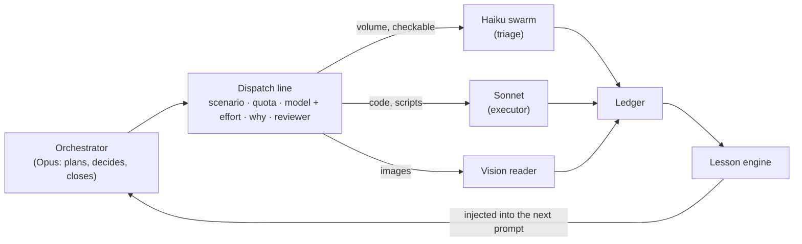

<p align="center">
  <picture>
    <source media="(prefers-color-scheme: dark)" srcset="assets/banner-dark.png">
    <source media="(prefers-color-scheme: light)" srcset="assets/banner-light.png">
    
  </picture>
</p>

**Your Opus plans. Haiku does the volume. Your quota lasts the week.**

A Claude Code plugin that routes every subagent to the cheapest model that gets it right, and proves it with numbers.

[](LICENSE)
[](https://docs.claude.com/en/docs/claude-code/plugins)
[](https://github.com/guilhermevargas51/swarmtier/actions/workflows/ci.yml)
[](https://github.com/guilhermevargas51/swarmtier/stargazers)


## The problem

In the usage data below, very little of the bill is the model thinking. Measured on one heavy-usage account over 30 days ([method](docs/cost-map.md#4-measured-shares-of-spend)):

- **Tool results are about 69% of all spend** (file reads about 27%, shell output about 26%). Reasoning is about 0.1%, replies about 2.6%.
- **Idle gaps are the largest single line** on the usage panel. Come back after the cache expires and the whole conversation is rewritten.
- **Haiku under 100k of context does about 27x the work of Opus per unit of quota** (about 14x Sonnet).

These are proportions from one account. Your mileage will vary; [measure your own](docs/cost-map.md#5-how-to-measure-your-own).

In [How We Build Effective Agents](https://ai.engineer/talks/effective-ai-agents), Barry Zhang (Anthropic) leaves budget-awareness as an open question: how do you explain and enforce a time, money or token budget to an agent? swarmtier is one practical answer for Claude Code. Every dispatch must state its effort, the quota reading carries its age, and swarms are sized to stay under the small-model ceiling.

## Quick start

```
/plugin marketplace add guilhermevargas51/swarmtier
/plugin install swarmtier@swarmtier
```

Requires Python 3.10+ on your PATH as `python`. Windows, macOS and Linux.

Optional second step: give your orchestrator the rules. Copy [`templates/CLAUDE.md`](templates/CLAUDE.md) into your project's `CLAUDE.md`, and [`templates/config.example.toml`](templates/config.example.toml) to `swarmtier.toml` in the project root (every key is optional).

**What you'll see.** Dispatch a subagent without `effort` and the `require-effort` hook blocks the call and tells the model how to fix it:

```
DISPATCH WITHOUT EFFORT. Choose model + effort for THIS task and repeat the call:
  extract / count / list / summarize        -> model haiku,  effort low
  classify against a ready criterion        -> haiku,        effort medium
  check an edge case                        -> haiku,        effort high
  ...
Write the dispatch line first: scenario - quota - agent/model + effort - why - who reviews.
```

Make a mistake once, record it, and the next similar prompt arrives with the lesson attached:

```
LESSONS LEARNED - we already got this wrong before. Read before acting:
  - [inline python in heredoc] heredoc python breaks on Windows quoting; write a temp .py file instead
```

## What's inside

| Component | What it does | Cost it prevents |
|---|---|---|
| `hooks/require-effort.py` | Blocks any `Agent` call with no `effort`; refuses `max` on Sonnet (configurable) | A subagent silently inheriting the session's effort |
| `hooks/delegation-ledger.py` | Records every dispatch, wait and failure | Delegation that nobody can audit |
| `hooks/cold-cache.py` | On the first prompt after an idle gap longer than the cache TTL, says so and counts cold returns per day | Paying the full-context rewrite twice |
| `hooks/cold-cache-watch.py` | At the end of a big turn, reminds you to checkpoint and `/compact` before stepping away | The rewrite on the way back |
| `hooks/lesson-inject.py` | Adds up to 3 relevant past lessons to the prompt before the model acts | Repeating a mistake already paid for |
| `hooks/lesson-capture.py` | Collects failed shell commands as lesson candidates and reminds you to record them | Failures that teach nothing |
| `hooks/user-correction.py` | Spots correction language ("that is wrong", "I told you") and injects a verify-at-the-source protocol | Fixing the symptom and missing the family of errors |
| `core.quota` | Stores the percentages you copy from `/usage`, with their age | Dispatching on a stale reading |
| `core.swarm_split` | Slices material into batches under the Haiku ceiling | Haiku batches above 100k, where work per quota drops about 5x |
| `core.learning`, `core.ledger` | Lesson store and delegation record behind the hooks | Lessons that live only in chat |
| `agents/triage` (Haiku) | Classify, extract, count against a criterion you provide | Using Sonnet or Opus for volume |
| `agents/executor` (Sonnet) | Scripts and edits with a check; stops and escalates when the same check fails twice | Expensive retries on hard tasks |
| `agents/vision-reader` (Sonnet) | Transcribes images literally, marks what it cannot read | Interpretation mixed into transcription |
| `skills/dispatch-by-cost` | The dispatch line, the cost map, control points | Choosing a model by habit |
| `skills/swarm-split` | When and how to fan out to parallel Haiku | Swarms that do not divide or cannot be verified |
| `skills/improve-skills` | Folds lessons back into the skill step that caused them | Lessons parked in a footer |

## How it works




The longer version, including governance, is in [docs/architecture.md](docs/architecture.md).

## The dispatch line

One line the orchestrator writes before every delegation. It forces three decisions that otherwise get skipped: who does the work, at what effort, and who reviews.

```
Scenario X · 5h N% / week N% (Nx pace) · -> agent/model + effort · why · who reviews
```

```
Scenario A · 5h 32% / week 58% (1.4x pace) · -> executor/Sonnet + medium · code with a test, week is over pace so no Opus subagent · reviewed against the test and one run of the real input
```

Fields and more examples: [docs/dispatch-line.md](docs/dispatch-line.md). The enforced part is `effort`.

## The cost map

Public benchmark data (Artificial Analysis, read 2026-10-07), summarized in six lines:

- Haiku xhigh scores about the same as Sonnet medium (41.2 vs 40.8) at one fifth of the price.
- Sonnet is for code, in medium. High if stuck. Never max.
- Sonnet high and xhigh lose to Opus medium, so a subagent that needs real intelligence gets Opus medium.
- Opus medium gives about 96% of Opus high for about 74% of the cost.
- Haiku at xhigh or max is verbose and slow: run it in the background.
- Lower hallucination is not more knowledge. Facts that must be exact stay with the orchestrator, checking the source.

Full table with index, cost per task, hallucination and tokens: [docs/cost-map.md](docs/cost-map.md).

## Quota

swarmtier does not read your quota; you tell it. Copy the two percentages from `/usage`:

```
python -m core.quota set --5h 42 --week 64
python -m core.quota show
```

```
5h window: 42.0%   weekly: 64.0%   (age 0s)   weekly pace: unknown
```

swarmtier never reads your token or credentials, and the code makes no network calls. The reading is a number you typed, stored locally with a timestamp, so a stale one can be recognized as stale. See [SECURITY.md](SECURITY.md).

## FAQ

<details>
<summary>Is this official from Anthropic?</summary>

No. swarmtier is an independent community project that works with Claude Code. It is not made, endorsed, or supported by Anthropic.
</details>

<details>
<summary>Does it work without Haiku?</summary>

Yes. Haiku saves the most, but the pieces are independent: the effort hook, the cold-cache warning, the ledger and the lesson engine do not need it. Without Haiku, point `triage` at Sonnet low and expect the swarm to cost more.
</details>

<details>
<summary>Where is my data stored?</summary>

Locally, in `data_dir` from your config, or `~/.swarmtier` (override with `SWARMTIER_HOME`). That holds the ledger, lessons and session timestamps. swarmtier itself sends nothing anywhere.
</details>

<details>
<summary>Can I trust the cost numbers?</summary>

The model and effort table comes from public Artificial Analysis pages, with date and source. The spend shares were measured on one account and are given only as proportions. Yours will differ; [docs/cost-map.md](docs/cost-map.md) shows how to measure them.
</details>

<details>
<summary>How do I turn off a hook?</summary>

Remove or comment its entry in `hooks/hooks.json`, or disable the plugin. To exempt only some agents from the effort check, list them in `exempt_agents`.
</details>

More in [docs/faq.md](docs/faq.md). Worked examples with commands: [examples/README.md](examples/README.md).

## Contributing

One pull request, one change. Run the tests and the privacy scan first. Details in [CONTRIBUTING.md](CONTRIBUTING.md).


## License

[MIT](LICENSE)

[🇧🇷 Leia em português](README.pt-BR.md)
