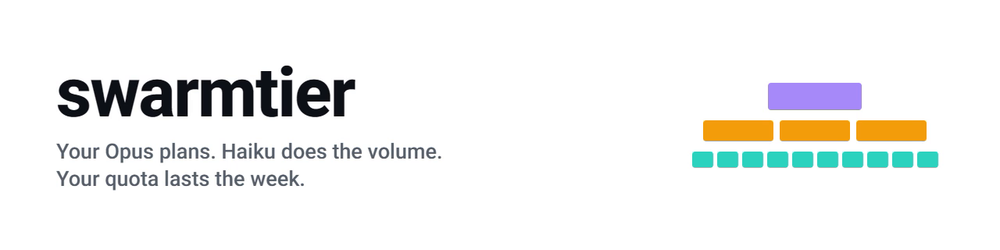
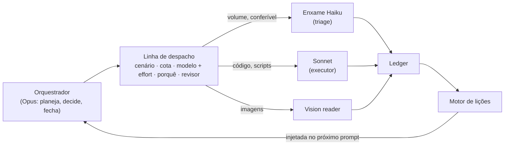
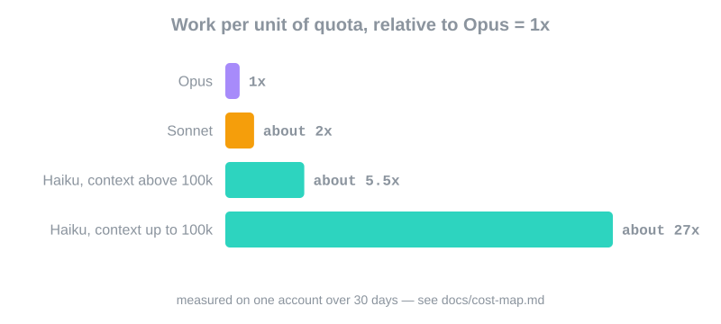

<p align="center">
  <picture>
    <source media="(prefers-color-scheme: dark)" srcset="assets/banner-dark.png">
    <source media="(prefers-color-scheme: light)" srcset="assets/banner-light.png">
    
  </picture>
</p>

**O Opus planeja. O Haiku faz o volume. A sua cota dura a semana inteira.**

Um plugin do Claude Code que manda cada subagente para o modelo mais barato que acerta, e mostra isso com números.

[](LICENSE)
[](https://docs.claude.com/en/docs/claude-code/plugins)
[](https://github.com/guilhermevargas51/swarmtier/actions/workflows/ci.yml)
[](https://github.com/guilhermevargas51/swarmtier/stargazers)


## O problema

Nos dados de uso abaixo, quase nada da conta é o modelo pensando. Medido em uma conta de uso pesado ao longo de 30 dias ([método](docs/cost-map.md#4-measured-shares-of-spend)):

- **Resultado de ferramenta é cerca de 69% de todo o gasto** (leitura de arquivo cerca de 27%, saída de shell cerca de 26%). Raciocínio é cerca de 0,1%, respostas cerca de 2,6%.
- **Intervalos ociosos são a maior linha isolada** do painel de uso. Se você volta depois que o cache expirou, a conversa inteira é reescrita.
- **Haiku abaixo de 100k de contexto rende cerca de 27x o trabalho do Opus por unidade de cota** (cerca de 14x o Sonnet).

São proporções de uma conta só. O seu resultado vai variar; [meça o seu](docs/cost-map.md#5-how-to-measure-your-own).

Na palestra [How We Build Effective Agents](https://www.youtube.com/watch?v=D7_ipDqhtwk), Barry Zhang (Anthropic) deixa a noção de orçamento como questão em aberto: como explicar e impor a um agente um limite de tempo, dinheiro ou tokens? O swarmtier é uma resposta prática para o Claude Code. Todo despacho declara o effort, a leitura da cota traz a idade, e o enxame é dimensionado para ficar abaixo do teto do modelo pequeno.

## Início rápido

```
/plugin marketplace add guilhermevargas51/swarmtier
/plugin install swarmtier@swarmtier
```

Precisa de Python 3.10+ no PATH como `python`. Windows, macOS e Linux.

Segundo passo, opcional: dar as regras ao orquestrador. Copie [`templates/CLAUDE.md`](templates/CLAUDE.md) para o `CLAUDE.md` do seu projeto e [`templates/config.example.toml`](templates/config.example.toml) para `swarmtier.toml` na raiz (todas as chaves são opcionais).

**O que você vai ver.** Despache um subagente sem `effort` e o hook `require-effort` barra a chamada e explica ao modelo como corrigir:

```
DISPATCH WITHOUT EFFORT. Choose model + effort for THIS task and repeat the call:
  extract / count / list / summarize        -> model haiku,  effort low
  classify against a ready criterion        -> haiku,        effort medium
  check an edge case                        -> haiku,        effort high
  ...
Write the dispatch line first: scenario - quota - agent/model + effort - why - who reviews.
```

Errou uma vez, registrou, e o próximo prompt parecido chega com a lição anexada:

```
LESSONS LEARNED - we already got this wrong before. Read before acting:
  - [inline python in heredoc] heredoc python breaks on Windows quoting; write a temp .py file instead
```

(As mensagens dos hooks ficam em inglês, porque é o que o modelo lê.)

## O que vem dentro

| Componente | O que faz | Custo que evita |
|---|---|---|
| `hooks/require-effort.py` | Barra qualquer chamada `Agent` sem `effort`; recusa `max` no Sonnet (configurável) | Subagente herdando em silêncio o effort da sessão |
| `hooks/delegation-ledger.py` | Registra cada despacho, espera e falha | Delegação que ninguém consegue auditar |
| `hooks/cold-cache.py` | No primeiro prompt depois de uma pausa maior que o TTL do cache, avisa e conta as voltas a frio do dia | Pagar duas vezes a reescrita do contexto inteiro |
| `hooks/cold-cache-watch.py` | No fim de um turno grande, lembra de salvar o estado e rodar `/compact` antes de sair | A reescrita na volta |
| `hooks/lesson-inject.py` | Anexa ao prompt até 3 lições passadas relevantes, antes de o modelo agir | Repetir um erro já pago |
| `hooks/lesson-capture.py` | Junta comandos de shell que falharam como candidatas a lição e lembra de registrar | Falha que não ensina nada |
| `hooks/user-correction.py` | Percebe linguagem de correção ("está errado", "já te disse") e injeta um protocolo de conferir na fonte | Corrigir o sintoma e deixar passar a família do erro |
| `core.quota` | Guarda os percentuais que você copia do `/usage`, com a idade | Despachar com base em leitura velha |
| `core.swarm_split` | Fatia o material em lotes abaixo do teto do Haiku | Lote de Haiku acima de 100k, onde o rendimento por cota cai cerca de 5x |
| `core.learning`, `core.ledger` | Banco de lições e registro de delegações por trás dos hooks | Lição que só existe no chat |
| `agents/triage` (Haiku) | Classifica, extrai e conta contra um critério que você entrega pronto | Usar Sonnet ou Opus para volume |
| `agents/executor` (Sonnet) | Scripts e edições com checagem; para e escala quando a mesma checagem falha duas vezes | Retentativa cara em tarefa difícil |
| `agents/vision-reader` (Sonnet) | Transcreve imagem literalmente e marca o que não conseguiu ler | Interpretação misturada com transcrição |
| `skills/dispatch-by-cost` | A linha de despacho, o mapa de custo, os pontos de controle | Escolher modelo por hábito |
| `skills/swarm-split` | Quando e como abrir um enxame de Haiku em paralelo | Enxame que não se divide ou não se confere |
| `skills/improve-skills` | Devolve a lição ao passo da skill que a causou | Lição esquecida no rodapé |

## Como funciona





A versão longa, com a parte de governança, está em [docs/architecture.md](docs/architecture.md) (em inglês).

## A linha de despacho

Uma linha que o orquestrador escreve antes de toda delegação. Ela força três decisões que costumam ser puladas: quem faz, em que effort, e quem revisa.

```
Scenario X · 5h N% / week N% (Nx pace) · -> agent/model + effort · why · who reviews
```

```
Scenario A · 5h 32% / week 58% (1.4x pace) · -> executor/Sonnet + medium · code with a test, week is over pace so no Opus subagent · reviewed against the test and one run of the real input
```

Campos e mais exemplos: [docs/dispatch-line.md](docs/dispatch-line.md). O que a ferramenta impõe é o `effort`.

## O mapa de custo

Dados públicos de benchmark (Artificial Analysis, lidos em 2026-10-07), em seis linhas:

- Haiku xhigh pontua quase igual ao Sonnet medium (41,2 contra 40,8) por um quinto do preço.
- Sonnet é para código, em medium. High se travar. Max nunca.
- Sonnet high e xhigh perdem para o Opus medium; então o subagente que precisa de inteligência de verdade recebe Opus medium.
- Opus medium entrega cerca de 96% do Opus high por cerca de 74% do custo.
- Haiku em xhigh ou max é prolixo e lento: rode em segundo plano.
- Menos alucinação não é saber mais. Fato que precisa estar exato fica com o orquestrador, conferindo a fonte.

Tabela completa com índice, custo por tarefa, alucinação e tokens: [docs/cost-map.md](docs/cost-map.md).

## Cota

O swarmtier não lê a sua cota; você informa. Copie os dois percentuais do `/usage`:

```
python -m core.quota set --5h 42 --week 64
python -m core.quota show
```

```
5h window: 42.0%   weekly: 64.0%   (age 0s)   weekly pace: unknown
```

O swarmtier nunca lê o seu token nem as suas credenciais, e o código não faz nenhuma chamada de rede. A leitura é um número que você digitou, guardado localmente com data e hora, para que uma leitura velha seja reconhecida como velha. Veja [SECURITY.md](SECURITY.md).

## FAQ

<details>
<summary>Isto é oficial da Anthropic?</summary>

Não. O swarmtier é um projeto independente da comunidade que funciona com o Claude Code. Não é feito, endossado nem suportado pela Anthropic.
</details>

<details>
<summary>Funciona sem o Haiku?</summary>

Funciona. O Haiku é onde mais se economiza, mas as peças são independentes: o hook de effort, o aviso de cache frio, o ledger e o motor de lições não dependem dele. Sem Haiku, aponte o `triage` para o Sonnet low e espere que o enxame custe mais.
</details>

<details>
<summary>Onde ficam os meus dados?</summary>

Localmente, em `data_dir` da sua configuração, ou em `~/.swarmtier` (dá para trocar com `SWARMTIER_HOME`). Ali ficam o ledger, as lições e os horários das sessões. O swarmtier não envia nada para lugar nenhum.
</details>

<details>
<summary>Posso confiar nos números de custo?</summary>

A tabela de modelo e effort vem das páginas públicas da Artificial Analysis, com data e fonte. As proporções de gasto foram medidas em uma conta só e aparecem apenas como proporção. As suas serão diferentes; [docs/cost-map.md](docs/cost-map.md) mostra como medir.
</details>

<details>
<summary>Como desligo um hook?</summary>

Remova ou comente a entrada dele em `hooks/hooks.json`, ou desative o plugin. Para dispensar só alguns agentes da checagem de effort, liste-os em `exempt_agents`.
</details>

Mais em [docs/faq.md](docs/faq.md) (inglês). Exemplos passo a passo com comandos: [examples/README.md](examples/README.md).

## Contribuindo

Um pull request, uma mudança. Rode os testes e a varredura de privacidade antes. Detalhes em [CONTRIBUTING.md](CONTRIBUTING.md).


## Licença

[MIT](LICENSE)

[🇺🇸 Read in English](README.md)
